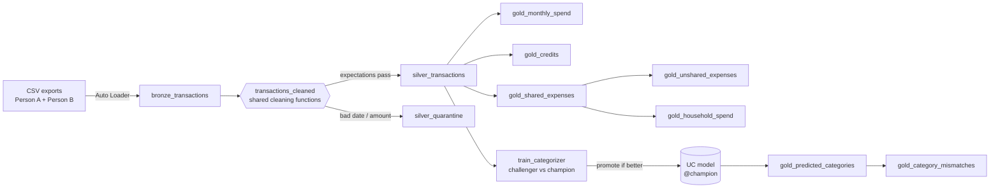
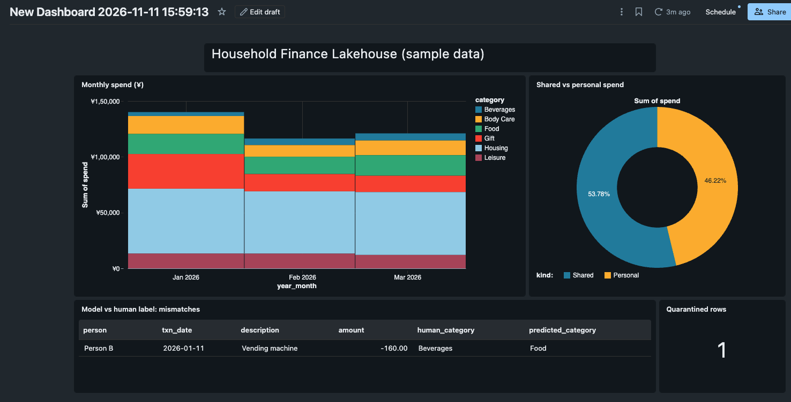

# Personal Finance Lakehouse

A Databricks lakehouse that two roommates use to track personal and shared
spending. Each person exports expenses from their own app (in a different
date format). The pipeline cleans and merges the exports, works out which
purchases were split, flags items only one person logged, and uses a small
ML model to catch mislabelled categories.

Built with **Delta Live Tables, Auto Loader, Unity Catalog, MLflow** and
deployed as a **Databricks Asset Bundle** with GitHub Actions CI/CD.

## Architecture



A daily job (`pf_daily`) refreshes the pipeline, then retrains the model.

## What each gold table answers

| Table | Question |
|---|---|
| `gold_monthly_spend` | How much did each person spend per month and category? |
| `gold_credits` | Which refunds or incoming payments were recorded? |
| `gold_shared_expenses` | Which purchases were split between us? |
| `gold_unshared_expenses` | Which expenses did only one of us log? (catches forgotten entries) |
| `gold_household_spend` | What does the household spend together each month? |
| `gold_predicted_categories` | What category does the model predict for each expense? |
| `gold_category_mismatches` | Where does the model disagree with the label? (mislabel or model gap) |

<!-- Add a dashboard screenshot built on the SAMPLE data, not real data:
 -->

## Design decisions

- **Tested code is the production code.** All cleaning and matching logic
  lives in `src/transforms/` as pure DataFrame-in/DataFrame-out functions.
  The DLT files only wire them up, and the unit tests import the same
  functions.
- **Quarantine, don't drop.** Rows with an unparseable date or amount go to
  `silver_quarantine` for review instead of disappearing. Refunds and income
  are kept as `direction = 'credit'`, not filtered out.
- **Shared-expense matching** pairs expenses with the same amount and
  category, logged by both people within `pf.shared_match_days` (default 3)
  days. Only mutual-best matches are kept, so each transaction is in at most
  one pair. A same-month rule was tried first and paired unrelated purchases.
- **Champion/challenger promotion.** Each training run registers a new model
  version as `@challenger`, scores the current `@champion` on the *same* test
  split, and promotes only if the challenger wins (`src/ml/promotion.py`).
  A worse model never goes live automatically.
- **Bootstrap-safe scoring.** Before any model exists, predictions are NULL
  rather than failing the pipeline.

## Run it

**Prerequisites:** a Databricks workspace (Free Edition works), the
[Databricks CLI](https://docs.databricks.com/dev-tools/cli/install.html),
Python 3.11+ and Java 17 for local tests.

```bash
# 1. One-time setup in a SQL editor (or notebook)
#    CREATE SCHEMA IF NOT EXISTS workspace.finance;
#    CREATE VOLUME IF NOT EXISTS workspace.finance.landing;

# 2. Generate sample data and upload it to the landing volume
python scripts/generate_sample_data.py
databricks fs cp data/sample/ dbfs:/Volumes/workspace/finance/landing/ --recursive

# 3. Deploy and run
databricks bundle validate
databricks bundle deploy -t dev
databricks bundle run pf_daily -t dev
```

Override any variable at deploy time, e.g.
`databricks bundle deploy -t dev --var="catalog=main" --var="schema=pf"`.

Real exports go in the same volume. They never belong in this repo; `data/`
is git-ignored except for the generated samples.

## Tests

```bash
pip install -r requirements-dev.txt
pytest -v
```

| File | Covers |
|---|---|
| `tests/test_cleaning.py` | date parsing in both formats, ANSI-safe casts, trimming, credit/expense labelling, txn ids |
| `tests/test_matching.py` | day-window matching, no double-matching, credits excluded, unshared detection |
| `tests/test_promotion.py` | champion/challenger rule |
| `tests/test_sample_data.py` | generator still produces every edge case |

## CI/CD

`.github/workflows/ci.yml`: unit tests on every push and PR,
`bundle validate` on PRs, `bundle deploy -t prod` on merge to `main`.
Needs `DATABRICKS_HOST` and `DATABRICKS_TOKEN` repository secrets.

## Project layout

```
databricks.yml              bundle: variables, pipeline, daily job
src/pipelines/              DLT definitions (bronze, silver, gold, gold_ml)
src/transforms/             pure, unit-tested transformation logic
src/ml/                     training script + promotion rule
scripts/                    sample data generator
tests/                      pytest suite
```
